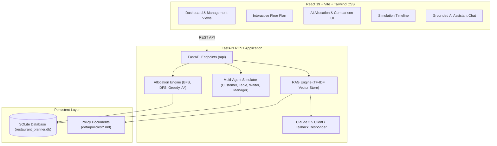

# AI-Based Restaurant Table Allocation and Service Planner

A full-stack, multi-agent restaurant service planner and simulator developed for CSE276. The system combines classical AI state-space search algorithms (Rule-Based, Greedy Search, BFS, DFS, and A*), an event-driven multi-agent simulation framework, and a grounded Retrieval-Augmented Generation (RAG) assistant using Claude API and local policy documents.

---

## 1. Project Introduction
**Saffron & Sage AI Bistro** is an enterprise-grade restaurant service planner designed to automate dining room operations. Managing a busy restaurant involves balancing customer party sizes against fixed table capacities, preventing server burnout, honoring advance reservations, and minimizing queue wait times. This application replaces manual maître d' guesswork with mathematically sound AI allocation algorithms and multi-agent discrete-event simulation.

---

## 2. Problem Statement
High-volume restaurants face four critical operational bottlenecks:
- **Capacity Mismatch**: Seating a 2-person walk-in at an 8-person banquet table wastes 75% of table capacity.
- **Workload Imbalance**: Over-allocating tables to single servers creates kitchen delays and reduced customer satisfaction.
- **Customer Queue Reneging**: When wait times exceed patience thresholds without dynamic scheduling, guests leave.
- **Policy Inconsistencies**: Manual errors in holding reservation grace periods or failing to reserve ground-floor wheelchair-accessible seating.

---

## 3. Project Objectives
1. Implement and compare 5 search algorithms (**Rule-Based, Greedy, BFS, DFS, A***) under identical constraints.
2. Model discrete-event multi-agent interactions (**CustomerAgent, TableAgent, WaiterAgent, ManagerAgent**).
3. Build a grounded **RAG Assistant** using Claude 3.5 Sonnet with a local non-hallucinating fallback.
4. Provide an interactive floor plan with live table turnover states (`AVAILABLE`, `OCCUPIED`, `RESERVED`, `CLEANING`, `UNAVAILABLE`).
5. Deliver a responsive SaaS dashboard with real-time analytics and zero non-functional controls.

---

## 4. Key Features
- **Interactive Floor Plan**: Visual table objects displaying capacity, current diner, assigned server, and status transitions.
- **AI Allocation Engine**: Automated matching minimizing a weighted multi-factor cost function with rejected alternatives and natural language explanations.
- **Side-by-Side Algorithm Benchmark**: Real-time comparisons of execution time, search nodes explored, table utilization, and total cost.
- **Discrete-Event Simulation**: Time-stepped simulator modeling arrivals, queue patience, service duration, and cleaning turnover.
- **Grounded AI Assistant**: Answers floor questions using live database queries and cited markdown policy documents.
- **Live Database Telemetry**: All metrics derive directly from SQLite database tables without hardcoded dummy numbers.

---

## 5. Technology Stack

### Frontend
- **Framework**: React 19 + Vite
- **Styling**: Tailwind CSS
- **Charts**: Recharts
- **Icons**: Lucide React
- **HTTP Client**: Native Fetch with typed API abstraction layer

### Backend
- **Framework**: Python 3.14 + FastAPI
- **Database & ORM**: SQLite + SQLAlchemy 2.0
- **Validation**: Pydantic v2 + Pydantic-Settings
- **Search Algorithms**: Rule-Based, Greedy, BFS, DFS, A*
- **Vector Indexing & RAG**: Scikit-Learn TF-IDF + Cosine Similarity
- **LLM Client**: Groq LPU Engine (`openai/gpt-oss-120b`) & Anthropic Claude API (with grounded SQLite fallback)
- **Testing**: Pytest

---

## 6. System Architecture



---

## 7. Database Schema

1. **`restaurant_tables`**:
   - `id`: Integer (PK)
   - `table_number`: String(20) (Unique, e.g. "T01")
   - `capacity`: Integer (Seats: 2, 4, 6, 8, 10)
   - `location`: String(50) ("Window", "Main Dining", "Booth Zone", "Patio", "Banquet Alcove")
   - `status`: String(20) (`AVAILABLE`, `OCCUPIED`, `RESERVED`, `CLEANING`, `UNAVAILABLE`)
   - `is_active`: Boolean
   - `current_waiter_id`: FK to `waiters.id`
   - `current_group_id`: FK to `customer_groups.id`

2. **`customer_groups`**:
   - `id`: Integer (PK)
   - `group_name`: String(100)
   - `group_size`: Integer
   - `arrival_time`: DateTime (UTC)
   - `reservation_time`: DateTime (Optional)
   - `priority`: Integer (1: Standard, 2: VIP, 3: High Priority)
   - `special_requirements`: String(255)
   - `status`: String(20) (`WAITING`, `SEATED`, `COMPLETED`, `CANCELLED`)

3. **`waiters`**:
   - `id`: Integer (PK)
   - `name`: String(100)
   - `availability`: Boolean
   - `max_tables`: Integer (Default: 4)
   - `assigned_tables`: Integer
   - `completed_orders`: Integer
   - `workload_score`: Float

4. **`reservations`**:
   - `id`: Integer (PK)
   - `customer_name`: String(100)
   - `group_size`: Integer
   - `reservation_date`: String ("YYYY-MM-DD")
   - `reservation_time`: String ("HH:MM")
   - `special_requests`: String(255)
   - `status`: String(20) (`CONFIRMED`, `SEATED`, `CANCELLED`, `NO_SHOW`)
   - `table_id`: FK to `restaurant_tables.id`

5. **`allocations`**:
   - `id`: Integer (PK)
   - `customer_group_id`: FK to `customer_groups.id`
   - `table_id`: FK to `restaurant_tables.id`
   - `waiter_id`: FK to `waiters.id`
   - `allocation_time`: DateTime
   - `algorithm_used`: String(50)
   - `allocation_reason`: Text

6. **`service_policies`**:
   - `id`: Integer (PK)
   - `policy_name`: String(150)
   - `description`: Text
   - `category`: String(50)
   - `is_active`: Boolean

7. **`simulation_records`**:
   - `id`: Integer (PK)
   - `simulation_name`: String(150)
   - `algorithm`: String(50)
   - `total_customers`: Integer
   - `successful_allocations`: Integer
   - `average_waiting_time`: Float
   - `execution_time`: Float (ms)
   - `utilization`: Float (%)
   - `created_at`: DateTime

---

## 8. AI Search Algorithms

### Multi-Factor Cost Function
$$\text{Cost} = w_{\text{waste}} \cdot \max(0, \text{Capacity}_t - \text{Size}_c) + w_{\text{load}} \cdot \text{Workload}_w + w_{\text{wait}} \cdot \frac{\text{WaitMins}_c}{\text{Priority}_c} + \text{Penalty}_{\text{miss}}$$

### Algorithm Implementations
1. **Rule-Based Allocation**: Deterministic IF/ELSE evaluation prioritizing:
   - Location match (Window, Booth, Patio).
   - Minimum capacity waste ($\min (\text{Capacity} - \text{Size})$).
   - Lowest waiter load below the 4-table limit.
2. **Greedy Search**: Myopically selects the lowest-cost $(c, t, w)$ combination at each iteration without backtracking.
3. **Breadth-First Search (BFS)**: Explores state nodes level-by-level using a FIFO queue. Tracks visited sets $(group\_index, used\_tables)$ to find the shortest allocation depth.
4. **Depth-First Search (DFS)**: Deep exploration down candidate branches with visited tracking and recursion/stack limits to prevent loops.
5. **A\* Search**: Explores the state space using a priority queue ordered by $f(n) = g(n) + h(n)$.
   - $g(n)$: Accumulated transition cost.
   - $h(n)$: Admissible heuristic estimating remaining minimum capacity waste:
     $$h(n) = \sum_{j=\text{curr}}^{N} \left( \min_{t \in \text{AvailableTables}} (\text{Cap}_t - \text{Size}_j) \cdot w_{\text{waste}} + \text{BaseWaitPenalty}_j \right)$$
   - **Optimality Claim**: Because $h(n) \le h^*(n)$ (underestimates true remaining cost by ignoring location mismatches and waiter bottlenecks), A* search guarantees minimal total service cost.

---

## 9. Multi-Agent Architecture
- **CustomerAgent**: Models dining parties, arrival times, party sizes, and tolerance limits. Automatically transitions to `RENEGED` if wait time exceeds patience limit.
- **TableAgent**: Encapsulates table state machine transitions:
  $$\text{AVAILABLE} \longrightarrow \text{OCCUPIED} \longrightarrow \text{CLEANING} \longrightarrow \text{AVAILABLE}$$
- **WaiterAgent**: Manages server thresholds, workload ratios, and active table lists.
- **ManagerAgent**: High-level coordinator that samples queue status, queries table/waiter availability, invokes the selected AI algorithm, and logs event timelines.

---

## 10. RAG Architecture & Grounded AI Assistant
1. **Markdown Knowledge Store**: Policies in `data/policies/*.md` cover reservations, hold windows, accessibility, and workload balancing.
2. **Vector Indexing**: Documents are chunked by section headers and embedded using TF-IDF feature matrices.
3. **Cosine Similarity Retrieval**: Matches user queries to the top-3 most relevant policy sections.
4. **Dual Execution Engine**:
   - **Claude API**: When `ANTHROPIC_API_KEY` is present, prompts Claude 3.5 Sonnet with live database state + retrieved policy context.
   - **Grounded Fallback**: When no API key is provided, the local engine parses query intent and computes factual answers directly from live SQLite database rows and retrieved policy snippets with cited references.

---

## 11. API Documentation (Swagger)
FastAPI provides automatic interactive OpenAPI documentation:
- **Swagger UI**: `http://127.0.0.1:8000/docs`
- **ReDoc**: `http://127.0.0.1:8000/redoc`

Key endpoints include:
- `GET /api/health`: Health status and active AI provider.
- `GET /api/dashboard/stats`: Real-time operational metrics.
- `GET /api/tables`, `POST /api/tables`, `PUT /api/tables/{id}/status`, `POST /api/tables/{id}/reset`: Table CRUD & state transitions.
- `GET /api/customers`, `POST /api/customers`: Customer queue management.
- `GET /api/waiters`, `POST /api/waiters`, `PUT /api/waiters/{id}`: Waiter workload management.
- `GET /api/reservations`, `POST /api/reservations`: Advance bookings.
- `POST /api/allocations/run`: Execute search algorithm allocation.
- `GET /api/allocations/compare`: Side-by-side benchmark of all 5 algorithms.
- `POST /api/simulation/start`, `POST /api/simulation/step`, `POST /api/simulation/reset`: Multi-agent simulator controls.
- `POST /api/ai/chat`: Grounded RAG conversational assistant.
- `POST /api/system/reset-db`: Re-seed sample benchmark database.

---

## 12. Installation Instructions

### Prerequisites
- Python 3.10+ (tested on Python 3.14)
- Node.js 18+ & npm (tested on Node v24)

### Clone / Navigate
```bash
cd restaurant-ai-planner
```

---

## 13. Environment Configuration

### Backend Environment (`backend/.env`)
Create `backend/.env` (a `.env.example` is provided):
```env
PROJECT_NAME="AI-Based Restaurant Table Allocation and Service Planner"
VERSION="1.0.0"
API_V1_STR="/api"
HOST="127.0.0.1"
PORT=8000
DEBUG=True
DATABASE_URL="sqlite:///./restaurant_planner.db"

# Optional: Claude API key (local grounded fallback activates if left blank)
ANTHROPIC_API_KEY=""
ANTHROPIC_MODEL="claude-3-5-sonnet-20241022"

CORS_ORIGINS=["http://localhost:5173", "http://127.0.0.1:5173", "http://localhost:3000"]
```

---

## 14. How to Run Frontend

```bash
cd frontend
npm install
npm run dev
```
The frontend starts at: `http://localhost:5173`

---

## 15. How to Run Backend

```bash
cd backend
python -m venv venv

# Windows:
.\venv\Scripts\activate
# macOS/Linux:
source venv/bin/activate

pip install -r requirements.txt
uvicorn app.main:app --host 127.0.0.1 --port 8000 --reload
```
The backend API starts at: `http://127.0.0.1:8000`

---

## 16. How to Run Tests

Run the complete automated pytest suite:
```bash
cd backend
.\venv\Scripts\pytest -v
```
All 17 automated tests verify algorithms, constraints, agents, simulation lifecycles, and API endpoints.

---

## 17. Future Scope
- Integration with live POS (Point of Sale) ordering hardware and kitchen display systems (KDS).
- Real-time customer SMS notification on table readiness via Twilio.
- Reinforcement learning (Deep Q-Networks) to train waiter routing policies based on historical dining duration distributions.
- 3D interactive WebGL restaurant floor rendering.
