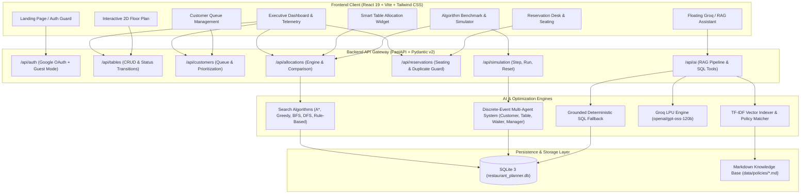
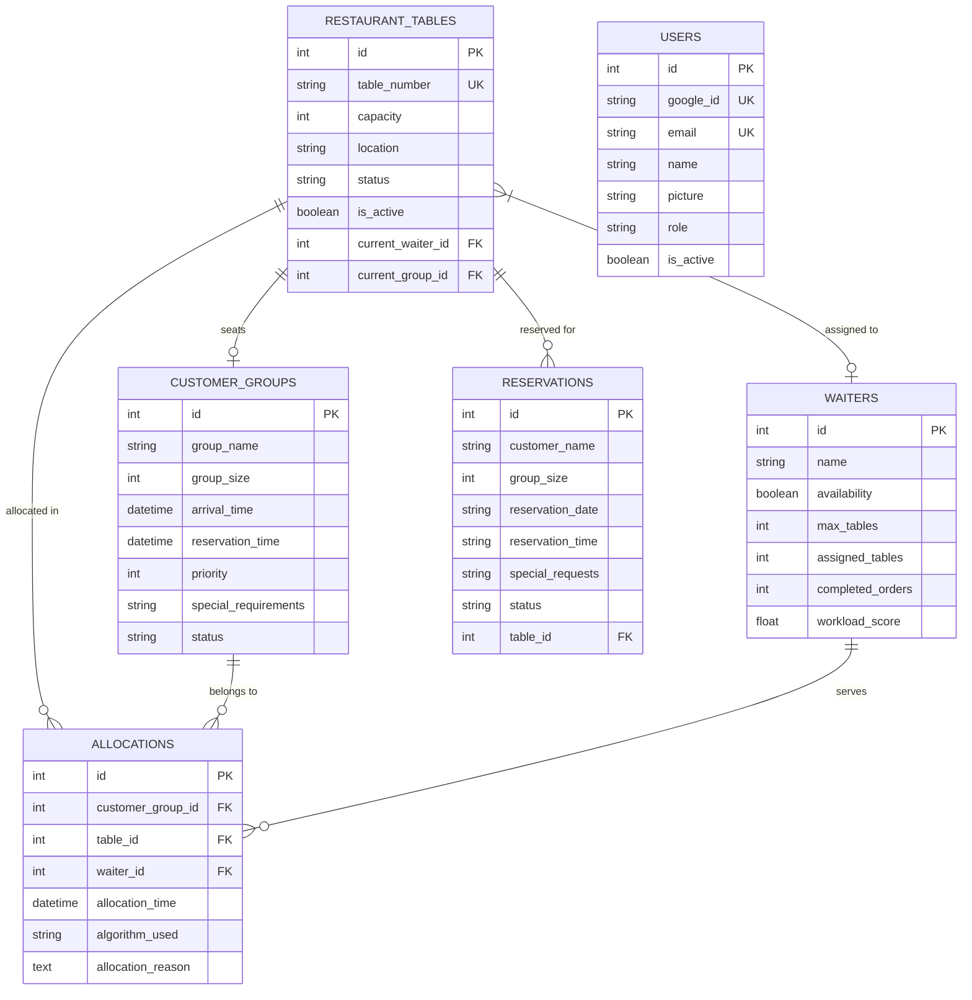

# 🍽️ Saffron & Sage | AI Bistro
### Intelligent Restaurant Table Allocation & Discrete-Event Service Planner

[](https://jiyasuteri.github.io/AI-Project/)
[](https://github.com/JiyaSuteri/AI-Project/actions)
[](https://github.com/JiyaSuteri/AI-Project)
[](https://fastapi.tiangolo.com/)
[](https://react.dev/)
[](LICENSE)

---

## 📌 Executive Overview

**Saffron & Sage AI Bistro** is a production-grade restaurant operations and service automation platform. High-volume dining establishments routinely suffer from four operational pain points: **capacity mismatches** (e.g., seating a party of 2 at an 8-top), **server burnout** (uneven table distribution), **customer queue reneging** (guests walking out due to unmanaged wait times), and **reservation hold conflicts**.

This project resolves these challenges by combining **graph search optimization algorithms** ($A^*$, Greedy, BFS, DFS, Rule-Based), **multi-agent discrete-event simulation**, and a **grounded Retrieval-Augmented Generation (RAG) AI assistant** powered by Groq LPU and Claude 3.5 Sonnet.

> **Project Author:** Jiya Suteri  
> **Course / Degree:** B.Tech Computer Science & Engineering (CSE276 Capstone)  
> **Institution:** Lovely Professional University, Punjab, India  
> **Repository:** [https://github.com/JiyaSuteri/AI-Project](https://github.com/JiyaSuteri/AI-Project)  
> **Interactive Production Demo:** [https://jiyasuteri.github.io/AI-Project/](https://jiyasuteri.github.io/AI-Project/)  

---

## 📑 Quick Navigation & Documentation Links

| Resource | Description | Format / Link |
|---|---|---|
| 🌐 **Live Web Application** | Deployed interactive frontend with simulated backend fallback | [GitHub Pages Deployment](https://jiyasuteri.github.io/AI-Project/) |
| 📘 **Formal Project Report** | Comprehensive academic thesis detailing algorithms, mathematical proofs, and benchmarks | [`docs/MAJOR_PROJECT_REPORT.md`](docs/MAJOR_PROJECT_REPORT.md) / [HTML](docs/MAJOR_PROJECT_REPORT.html) |
| 🖥️ **Presentation Deck** | Interactive 10-slide presentation deck formatted for project defense | [`docs/PROJECT_PRESENTATION_SLIDES.html`](docs/PROJECT_PRESENTATION_SLIDES.html) |
| 🎙️ **Defense Script & Q&A** | Complete slide-by-slide presenter talk-track and examiner viva prep | [`docs/PROJECT_PRESENTATION_PPT.md`](docs/PROJECT_PRESENTATION_PPT.md) |
| ⚡ **Interactive API Docs** | Auto-generated OpenAPI / Swagger documentation (when backend running) | `http://127.0.0.1:8000/docs` |

---

## 🏛️ System Architecture

The application is structured as a clean, decoupled monorepo following modern enterprise microservice-friendly patterns:



---

## ⚙️ Core Engineering Modules

### 1. AI Table Allocation Engine
The allocation engine dynamically maps dining parties to candidate tables while optimizing multiple competing constraints simultaneously.

#### Mathematical Cost Function
The search objective minimizes the total system cost:
$$\text{Cost} = w_{\text{waste}} \cdot \max(0, \text{Capacity}_t - \text{Size}_c) + w_{\text{load}} \cdot \text{Workload}_w + w_{\text{wait}} \cdot \frac{\text{WaitMins}_c}{\text{Priority}_c} + \text{Penalty}_{\text{miss}}$$

Where:
- $w_{\text{waste}} = 1.0$: Penalizes underutilization of physical seating capacity.
- $w_{\text{load}} = 2.0$: Balances server table counts to prevent bottlenecking.
- $w_{\text{wait}} = 0.5$: Weighs customer wait duration scaled by loyalty tier (Standard = 1, VIP = 2, High Priority = 3).
- $\text{Penalty}_{\text{miss}} = 50.0$: Applied when special requirements (e.g., wheelchair accessibility, window preference) cannot be met.

#### Algorithm Implementations & Complexity
| Algorithm | Exploration Strategy | Time Complexity | Space Complexity | Guarantees |
|---|---|---|---|---|
| **Rule-Based** | Deterministic heuristics (Capacity Fit $\to$ Location $\to$ Server Load) | $\mathcal{O}(N \cdot T)$ | $\mathcal{O}(1)$ | Fast, predictable baseline |
| **Greedy Search** | Lowest single-step cost $(c, t, w)$ without backtracking | $\mathcal{O}(N \cdot T \log T)$ | $\mathcal{O}(N)$ | Fast, prone to local minima |
| **Breadth-First (BFS)** | Level-order queue traversal with state deduplication | $\mathcal{O}(b^d)$ | $\mathcal{O}(b^d)$ | Shortest allocation depth |
| **Depth-First (DFS)** | Deep branch exploration with visited pruning | $\mathcal{O}(b^m)$ | $\mathcal{O}(b \cdot m)$ | Low memory, non-optimal |
| **$A^*$ Search** | Priority queue ordered by evaluation function $f(n) = g(n) + h(n)$ | $\mathcal{O}(b^d)$ | $\mathcal{O}(b^d)$ | **Provably optimal** minimum system cost |

> **Admissibility of $A^*$ Heuristic:**  
> The heuristic function estimates remaining capacity waste:
> $$h(n) = \sum_{j=\text{curr}}^{N} \left( \min_{t \in \text{Available}} (\text{Cap}_t - \text{Size}_j) \cdot w_{\text{waste}} \right)$$
> Because $h(n) \le h^*(n)$ (it ignores waiter congestion and constraint penalties), $h(n)$ never overestimates the true remaining cost, guaranteeing admissible, optimal solutions.

---

### 2. Discrete-Event Multi-Agent Simulation
A high-fidelity simulator models dining room interactions as autonomous communicating agents:
- **`CustomerAgent`**: Generates stochastic arrivals, requests seating, tracks individual patience thresholds, and triggers queue reneging if wait times exceed tolerance.
- **`TableAgent`**: Implements a strict finite-state machine:
  $$\text{AVAILABLE} \xrightarrow{\text{Seat}} \text{OCCUPIED} \xrightarrow{\text{Dine Complete}} \text{CLEANING} \xrightarrow{\text{Busboy Reset}} \text{AVAILABLE}$$
- **`WaiterAgent`**: Tracks active table assignments, caps capacity at 4 tables per server, and computes dynamic workload scores ($\frac{\text{assigned}}{\text{max}}$).
- **`ManagerAgent`**: Coordinator agent running periodic scheduling sweeps, dispatching busboys for table turnover, and logging simulation performance metrics.

---

### 3. Grounded RAG Assistant & Hybrid AI Engine
- **Knowledge Base**: Policy documents in `backend/data/policies/*.md` governing reservations, dietary guidelines, wheelchair accessibility, and overtime protocols.
- **Vector Retrieval**: Text chunking by semantic headers with TF-IDF vector embeddings and cosine similarity scoring.
- **Dual Inference Engine**:
  - **Groq LPU Engine**: High-speed cloud inference via `openai/gpt-oss-120b` or Claude 3.5 Sonnet.
  - **Zero-Hallucination Fallback**: When no API key is supplied, a deterministic SQL engine answers questions directly from live SQLite tables and policy excerpts with cited references.

---

### 4. Enterprise Reservation Desk & Duplicate Guard
- **One-Click Seating**: Atomically transitions a reservation to `SEATED`, provisions an active customer record, marks the assigned table as `OCCUPIED`, increments server workload, and writes an allocation audit entry.
- **Race Condition & Duplicate Prevention**: Backend enforces strict state validation—subsequent seating requests on an already seated booking immediately reject with **HTTP 409 Conflict**:
  ```json
  { "detail": "This reservation has already been seated." }
  ```

---

## 🗄️ Database Schema & Relational Model



---

## 💻 Tech Stack & Dependencies

| Layer | Technology | Version | Purpose |
|---|---|---|---|
| **Frontend** | React | `19.0.0` | Declarative UI framework |
| **Bundler** | Vite | `8.3.5` | Instant HMR development and optimized production bundling |
| **Styling** | Tailwind CSS | `3.4.17` | Utility-first responsive design (Warm Ivory, Sage Green, Terracotta) |
| **Icons** | Lucide React | `^0.460.0` | Consistent SVG interface iconography |
| **Charts** | Recharts | `^2.13.3` | Real-time telemetry, wait-time histograms & workload charts |
| **Backend** | Python | `3.10+ / 3.14` | Core backend runtime |
| **Framework** | FastAPI | `0.115.4` | High-performance asynchronous REST API framework |
| **ASGI Server** | Uvicorn | `0.32.0` | Production ASGI web server |
| **ORM** | SQLAlchemy | `2.0.36` | Database modeling and transactional abstraction |
| **Data Validation** | Pydantic v2 | `2.9.2` | Request/response schema validation and settings |
| **NLP & RAG** | Scikit-Learn | `1.5.2` | TF-IDF vectorization and cosine similarity calculations |
| **LLM Inference** | Groq SDK | `0.11.0` | Ultra-fast Groq LPU API client (`openai/gpt-oss-120b`) |
| **Test Runner** | Pytest | `9.2.0` | Comprehensive test suite (28 passing tests) |

---

## 📂 Repository Directory Structure

```text
restaurant-ai-planner/
├── .github/
│   └── workflows/
│       └── deploy.yml            # Automated GitHub Actions deployment to GitHub Pages
├── backend/
│   ├── app/
│   │   ├── ai/                   # RAG service, TF-IDF vector search, Groq client
│   │   ├── algorithms/           # Rule-Based, Greedy, BFS, DFS, A* implementations
│   │   ├── database/             # SQLite session manager and database setup
│   │   ├── models/               # SQLAlchemy models (Tables, Customers, Waiters, etc.)
│   │   ├── routes/               # FastAPI modular APIRouters (auth, tables, ai, etc.)
│   │   ├── schemas/              # Pydantic request and response schemas
│   │   ├── services/             # Auth service and business logic helpers
│   │   ├── simulation/           # Multi-agent discrete-event simulation classes
│   │   ├── config.py             # App configuration via pydantic-settings
│   │   └── main.py               # FastAPI application entrypoint and middleware
│   ├── data/policies/            # Markdown policy documents for RAG grounding
│   ├── scripts/                  # Automated integration tests and cleanup utilities
│   ├── tests/                    # 28 passing pytest test modules
│   ├── requirements.txt          # Python dependencies
│   ├── pytest.ini               # Pytest configuration
│   └── .env.example              # Template backend environment variables
├── frontend/
│   ├── src/
│   │   ├── components/           # Reusable UI widgets (Navbar, Sidebar, Modals, FloorPlan)
│   │   ├── context/              # React Context (AuthContext, RestaurantContext)
│   │   ├── pages/                # Page components (Dashboard, Tables, Queue, etc.)
│   │   ├── services/             # Typed API client with mockData fallback for demo
│   │   ├── App.jsx               # Root component with routing and auth guards
│   │   ├── index.css             # Tailwind design system tokens and styling
│   │   └── main.jsx              # React DOM mounting
│   ├── package.json              # Frontend npm dependencies and scripts
│   ├── vite.config.js            # Vite build configuration (base: './')
│   ├── tailwind.config.js        # Custom palette: Sage, Terracotta, Ivory
│   └── .env.example              # Frontend environment configuration template
├── docs/
│   ├── MAJOR_PROJECT_REPORT.md   # Full academic thesis and engineering documentation
│   ├── MAJOR_PROJECT_REPORT.html # Formatted, print-ready formal thesis
│   ├── PROJECT_PRESENTATION_PPT.md # Slide presentation script and viva defense Q&A
│   └── PROJECT_PRESENTATION_SLIDES.html # Interactive HTML presentation deck
├── .gitignore                    # Comprehensive ignore rules (.db, .env, dist, node_modules)
├── render.yaml                   # Cloud deployment specification for Render
└── README.md                     # Project documentation
```

---

## 🚀 Getting Started (Local Development)

### Prerequisites
- **Python**: `3.10` or higher (verified on Python 3.14)
- **Node.js**: `18.x` or higher (verified on Node 20 / 22)
- **Git**

---

### Step 1: Clone the Repository
```bash
git clone https://github.com/JiyaSuteri/AI-Project.git
cd AI-Project
```

---

### Step 2: Backend Setup
```bash
cd backend

# Create and activate virtual environment
# Windows (PowerShell):
python -m venv venv
.\venv\Scripts\Activate.ps1

# Linux / macOS:
python3 -m venv venv
source venv/bin/activate

# Install dependencies
pip install -r requirements.txt

# Create .env from template
cp .env.example .env

# Run FastAPI backend
uvicorn app.main:app --host 127.0.0.1 --port 8000 --reload
```
The backend API is now running at: **`http://127.0.0.1:8000`**  
Interactive Swagger docs: **`http://127.0.0.1:8000/docs`**

---

### Step 3: Frontend Setup
Open a new terminal window:
```bash
cd frontend

# Install npm packages
npm install

# Start Vite development server
npm run dev
```
The frontend is now available at: **`http://127.0.0.1:5173`**

---

## 🧪 Testing & Quality Assurance

The codebase includes comprehensive unit, integration, and end-to-end regression test suites.

### Running Backend Unit & Integration Tests (Pytest)
```bash
cd backend
.\venv\Scripts\pytest -v
```

**Results (28/28 Passing):**
- `tests/test_agents.py`: Verifies state machines for CustomerAgent, TableAgent, WaiterAgent, and ManagerAgent.
- `tests/test_algorithms.py`: Validates constraint satisfaction, optimality, and termination for all 5 search algorithms.
- `tests/test_api.py`: Validates REST endpoints, error status codes, and JSON response schemas.
- `tests/test_auth.py`: Tests Google OAuth JWT verification, Guest Mode token generation, and role authorization.
- `tests/test_phase4_dashboard_algorithms.py`: Confirms real-time telemetry calculations and allocation previews.

### Running End-to-End Seating & Duplicate Prevention Test
```bash
cd backend
.\venv\Scripts\python.exe scripts/test_all_fixes.py
```
*Validates the atomic seating transaction, table state transitions, server load updates, and asserts HTTP 409 rejection on duplicate requests.*

---

## 🌐 Production Deployment

### Frontend (GitHub Pages)
The frontend is automated via GitHub Actions in [`.github/workflows/deploy.yml`](.github/workflows/deploy.yml).
- **Trigger**: Every push to the `main` branch.
- **Action**: Installs dependencies (`npm ci`), compiles production bundles (`npm run build`), configures SPA routing fallbacks (`cp dist/index.html dist/404.html`), and deploys to GitHub Pages.
- **Live URL**: [https://jiyasuteri.github.io/AI-Project/](https://jiyasuteri.github.io/AI-Project/)

### Full-Stack Hosting (Render / Docker)
A ready-to-use [`render.yaml`](render.yaml) blueprint is included in the repository for deploying both the FastAPI backend and React frontend with persistent disks and environment secrets.

---

## 📄 License & Attribution

This project is licensed under the **MIT License** — see the [LICENSE](LICENSE) file for full details.

Developed with ❤️ by **Jiya Suteri**  
Bachelor of Technology in Computer Science & Engineering  
Lovely Professional University, Punjab, India  
GitHub: [@JiyaSuteri](https://github.com/JiyaSuteri)
